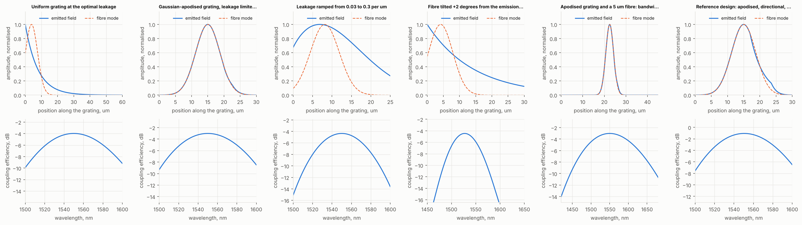

# GratingForge

A design model for surface grating couplers in Rust, with no dependencies: slab modes, phase matching, the field emitted by a uniform or apodised grating, its overlap with a tilted fibre mode, the coupling spectrum and bandwidth, and a two-beam estimate of the substrate reflection.

The repository is also a library of 99 coupler designs. Each design file states in its first lines what it shows and what it is checked against, and carries the result as machine-checked expectations. Every design is recomputed from its file by an independent SciPy calculation.

This is the model used before a full electromagnetic simulation, not a replacement for one. See "Reading the numbers".

## What is inside

| Part | Where | Content |
|---|---|---|
| Materials | `engine/src/optics/material.rs` | silicon, oxide, nitride with linear dispersion; constant indices |
| Slab modes | `optics/slab.rs` | TE and TM modes of a three-layer slab, any order, cut-off |
| Grating equation | `optics/grating.rs` | period for an angle, angle for a period, radiating orders, second-order wavelength |
| Emission | `optics/emission.rs` | uniform, linear and Gaussian-target leakage profiles, emitted field, radiated fraction |
| Fibre | `optics/fibre.rs` | overlap with a tilted Gaussian mode, optimal position |
| Substrate | `optics/substrate.rs` | upward fraction against buried-oxide thickness |
| Designs | `design/` | text format, analysis, spectrum, bandwidths, nineteen kinds of expectation |
| Library | `cases/*.gc` | 99 designs in nine families |
| Reference | `src/gratingforge/reference.py` | the same quantities computed independently in NumPy and SciPy |
| Results | `reports/cases/*.json`, `reports/figures/cases/*.png` | metrics, checks, emitted field and spectrum of every design |

53 Rust tests; pytest runs every design of the library as its own test.

## Results

99 designs, 528 expectations in the design files plus 100 independent recomputations: 628 checks, all passing. Full tables in `reports/report.md`.

| Family | Designs | What is verified |
|---|---|---|
| Slab modes | 14 | effective indices of 220 to 340 nm silicon and 400 to 800 nm nitride, TE and TM, to 2e-7 |
| Angle and period | 20 | period, angle, radiating orders, second-order wavelength, angular dispersion |
| Wavelength bands | 4 | the same recipe at 1.27, 1.31, 1.5 and 1.625 um |
| Uniform gratings | 11 | overlap against leakage and length from an error-function closed form; the 80.1% limit |
| Apodised gratings | 11 | Gaussian-target and linear leakage profiles, with a limit on the leakage |
| Fibre alignment | 13 | mode size, tilt error, position along the grating |
| Bandwidth | 10 | 1 dB and 3 dB widths; the Gaussian-beam formula within 1% for apodised designs |
| Substrate | 11 | upward fraction against oxide thickness and its period |
| Platforms | 5 | air-clad silicon, 340 nm silicon, nitride, TM, and one design using every part of the model |

Agreement between the Rust library and the SciPy reference over the whole library: indices to 5e-11, angles and periods to 5e-9 (the printed precision), overlap and efficiency to 6e-6, the whole spectrum to 3e-6, bandwidths to 4e-4 nm.



## Four things the model makes visible

1. **A uniform grating tops out at 80%.** The overlap of a decaying exponential with a Gaussian peaks at 80.1% when leakage times beam radius is 1.37. For a 10.4 um fibre at 10 degrees that is a leakage of 0.26 per um. Half that leakage costs 0.6 dB, a little over double costs 0.8 dB.
2. **Apodisation needs a strong etch.** Emitting a Gaussian requires the leakage to keep rising along the grating. Limited to 0.2 per um the overlap is 94%; at 0.4 it is 99%; above 0.8 it is complete.
3. **Bandwidth is set by the beam size and the group index.** The 1 dB width is 41 nm for a 10.4 um fibre on silicon, 86 nm for a 5 um mode, and 84 nm on nitride, in line with lambda^2 / (w (n_group - n_clad sin(theta))).
4. **A tilt error is a wavelength error.** Two degrees of fibre tilt cost 1.5 dB at 1550 nm, but the peak has only moved 23 nm, at 11 nm per degree, and is nearly as high there.

## Reading the numbers

- The leakage rate and the upward fraction of the grating alone are inputs, not results. Obtaining them from an etch depth and fill needs an electromagnetic solver (FDTD, eigenmode expansion). Efficiencies here are therefore conditional on those inputs; with the default upward fraction of 0.5 nothing exceeds -3 dB.
- The mean index of the grating is the fill-weighted average of two slab indices. This is a first-order estimate: for a 70 nm etch it is typically within a few hundredths of a rigorous Bloch-mode index, which moves the emission angle by a degree or two. Periods from this model are starting points for a sweep.
- Back-reflection, scattering at the grating entrance and the penalty of a second radiating order are not modelled. The library reports how many orders radiate (nitride and TM designs have two) but does not take power away for them.
- An apodised grating is assumed to keep a linear emitted phase. In practice the period has to be corrected tooth by tooth to achieve that.
- The 80.1% limit is for a long grating. The reported overlap is relative to the radiated power, so a short grating that cuts the useless tail can show a slightly higher overlap (up to 83% in the library) while its efficiency is lower.
- The substrate model is a two-beam estimate. It reproduces the period of the oscillation in oxide thickness (0.545 um at 10 degrees) and the size of the swing (0.30 to 0.71 for an intrinsic 0.5), not the absolute thickness of the maxima, which depends on phases the model does not have.
- Materials use linear dispersion around 1.55 um. O-band designs give their indices as numbers for that reason.
- The model is two-dimensional: the transverse overlap of the waveguide taper with the fibre mode is not included.
- The expectations in the design files and the recomputation in the report come from the same independent calculation. They verify the library's numerics, not the physical model, and there is no comparison with measured devices or with a rigorous solver in this repository.
- The per-design result files and figures are generated by `make run`; they are stored so that the library can be browsed without building anything.

## Run it

```
pip install -e ".[dev]"
make build      # cargo build --release
make test       # cargo test, then pytest (every design is a test)
make run        # analyses the library, writes reports/
```

One design:

```
engine/target/release/gratingforge check cases/mat_reference.gc
python scripts/analyse.py cases/apod_gauss_cap080.gc
python scripts/plot_design.py cases/fibre_tilt_p2.gc field.png
python scripts/compare_reference.py cases/box_thick20.gc
```

A design file:

```
# Every part of the model at once.
title Reference design: apodised, directional, on a tuned oxide
stack core=0.22 box=2.0
grating angle=10 length=30
leak 0.5
apodise gaussian
up 0.7
substrate on

expect period 0.63451311 1e-07
expect efficiency_db -1.05873 0.0005
```

From Rust:

```rust
use gratingforge::design::{analyse::analyse, parse::parse};

let spec = parse("grating angle=8 etch=0.07 length=25\nleak 0.2\nfibre mfd=9.2\n")?;
let a = analyse(&spec)?;
println!("period {:.1} nm, {:.2} dB, {:.1} nm wide", 1e3 * a.period, 10.0 * a.efficiency.log10(), a.bandwidth_1db);
```

## Layout

```
engine/src/          optics (material, slab, grating, emission, fibre, substrate), design, math, command line binary
engine/tests/        integration tests, one file per subject
engine/examples/     three short programs
cases/               99 designs, each with its description and expectations
src/gratingforge/    Python driver, independent reference, comparison, report and figures
docs/                design file reference, methods and formulas
reports/             report, validation table, per-design results and figures
```

## Author

Amir Masominia. PhD in physics (Université Paris-Saclay); postdoctoral researcher working on machine-learning surrogate models, numerical simulation and automated measurement pipelines.

MIT licence.
